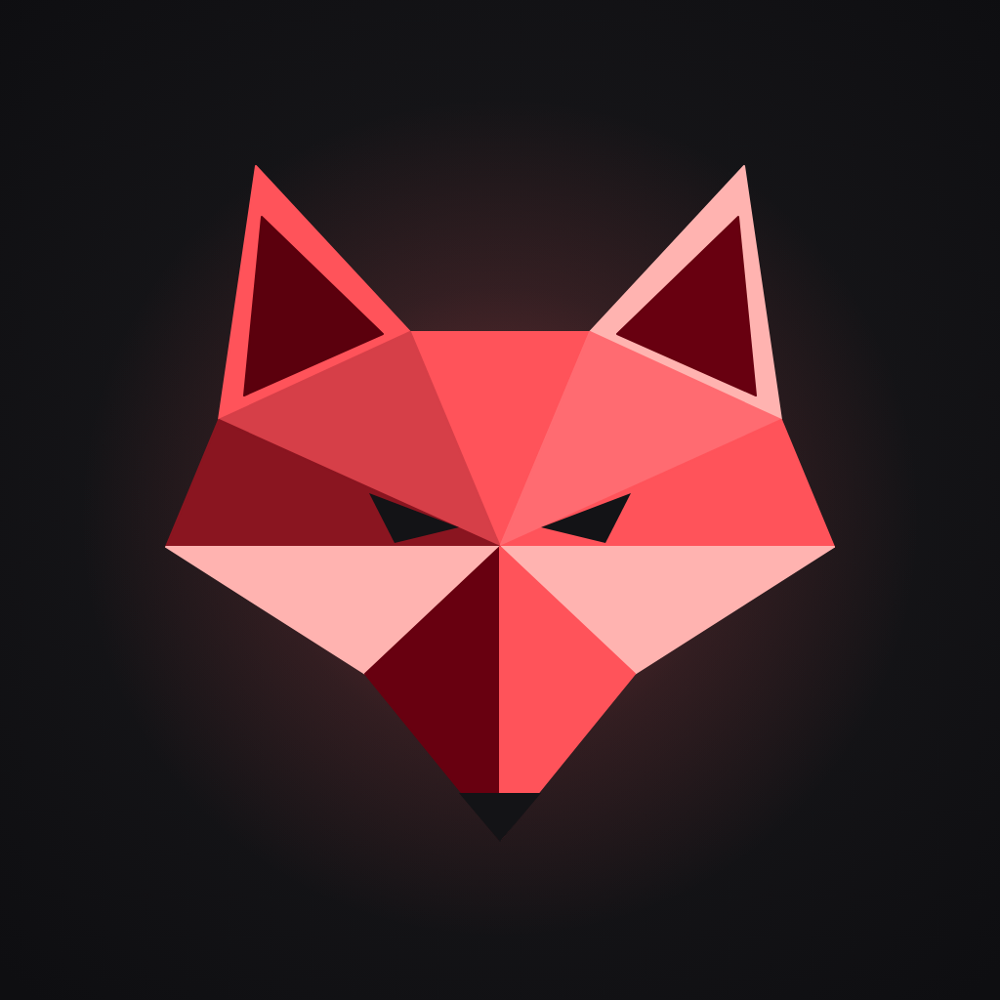

  

<h1 align="center">Redfox OSS</h1>

  <b>Open-source alternatives to the apps you use every day. 
  Except ours feel way too good.</b>

---

Your phone's stock apps work. They just don't feel like anything. Redfox OSS rebuilds the everyday ones (messages, alarms, and whatever comes next) as free, open-source Android apps that you can read, fork and trust. Then we polish them until they feel better than the originals.

Every app shares one look: **Obsidian**. Always-dark surfaces, a single vivid accent, soft coloured glows, frosted glass, and spring motion you can interrupt at any moment. Open one Redfox app and you already know how the rest feel.

## The apps

### 💬 [Messages](https://github.com/Redfox-OSS/messages)
A default SMS and MMS app built to replace your phone's messaging app.
- Conversations, group texts, photos and voice notes over MMS
- One-time codes pop up as a live notification with a one-tap **Copy** button
- Starred messages, scheduled sends, pinned and archived threads
- Swipe actions you choose yourself, per direction
- No internet access: your messages never leave your phone

### ⏰ [Alarmzy](https://github.com/Redfox-OSS/Alarmzy)
An alarm clock with **alarm groups**, a feature Google Clock doesn't have and Samsung keeps to its own phones.
- Put alarms into named groups (Work, Gym, Weekend) and switch a whole group on or off with one tap
- Custom repeat days, snooze length, gradual volume and vibration
- A full-screen alarm over the lock screen

### 🔮 [Obsidian](https://github.com/Redfox-OSS/obsidian)
The design system behind both apps, built with Jetpack Compose and free for your own apps too.
- Tokens, glows, frosted glass, motion and dozens of ready-made components
- A catalog app that shows every piece on a real phone
- Published from GitHub Pages: no account or token needed · [Docs](https://redfox-oss.github.io/obsidian/)

## Why Redfox?

| | Stock apps | Redfox OSS |
|---|---|---|
| Source code | Closed | Open, on GitHub |
| Price | Free | Free |
| Design | Fine | Dark, glowing, faceted, and it *feels* good |
| Your data | Their cloud, their rules | On your phone |
| Feature missing? | Wait and hope | Open an issue, or send a pull request |

## Get involved

- ⭐ Star the repos you like; it helps others find them.
- 🐛 Found a bug? Open an issue in the app's repository.
- 🛠️ Want to contribute? Read [CONTRIBUTING.md](https://github.com/Redfox-OSS/.github/blob/main/CONTRIBUTING.md) and our [Code of Conduct](https://github.com/Redfox-OSS/.github/blob/main/CODE_OF_CONDUCT.md).
- 🔒 Security problem? Please report it privately; see [SECURITY.md](https://github.com/Redfox-OSS/.github/blob/main/SECURITY.md).

Made with care, and a lot of Crimson <code>#FF535A</code>.

