

  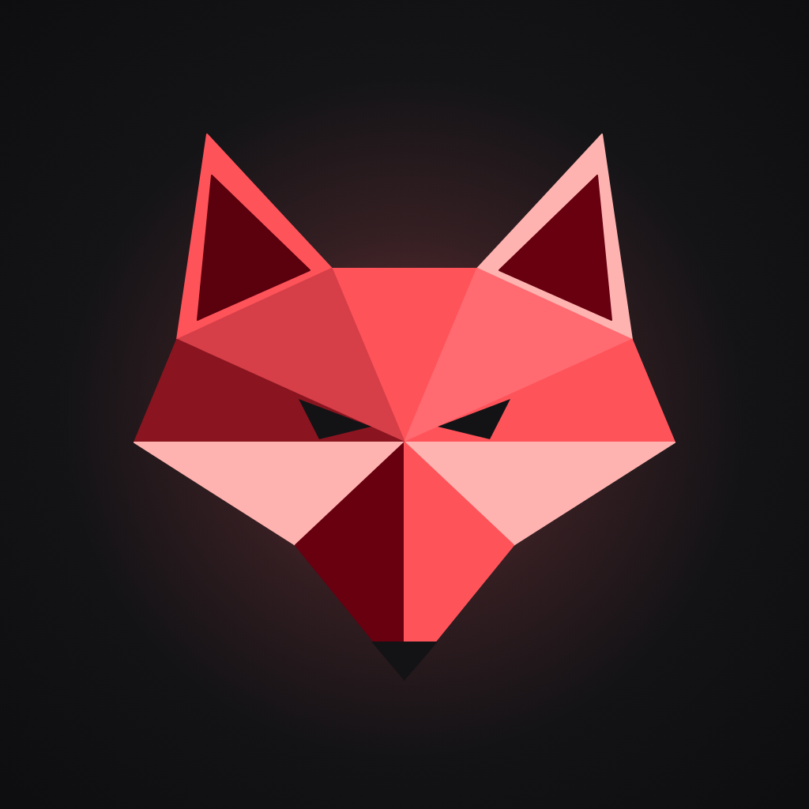

<h1 align="center">Redfox OSS</h1>

  <b>Open-source alternatives to the apps you use every day. 
  Except ours feel way too good.</b>

---

Your phone's stock apps work. They just don't feel like anything. Redfox OSS rebuilds the everyday ones (messages, alarms, and whatever comes next) as free, open-source Android apps that you can read, fork and trust. Then we polish them until they feel better than the originals.

Every app shares one look: **Bedrock**. Dark surfaces, frosted glass with a lit rim, colour that lives inside surfaces instead of glowing around them, and calm motion where nothing overshoots. Open one Redfox app and you already know how the rest feel.

## The apps

### 💬 [Messages](https://github.com/Redfox-OSS/messages-bedrock)
A default SMS and MMS app built to replace your phone's messaging app. No internet permission, so your messages never leave your phone.
- Your existing texts load straight from Android's message store, so switching is painless
- One-time codes pop up as a live notification with tap-to-copy, hidden from clipboard history
- Starred messages and scheduled sends (even across reboots) in one **Saved** tab
- On-device full-text search, MMS photos, group texts, voice notes and dual SIM
- Swipe actions you choose yourself, per direction

  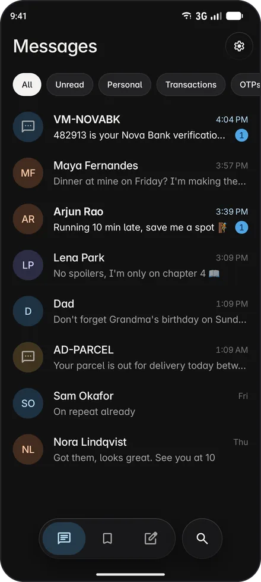
  &nbsp;
  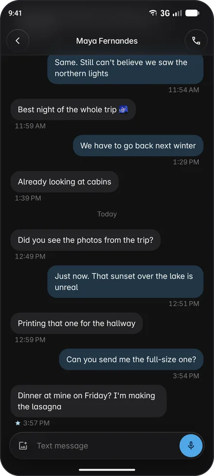
  &nbsp;
  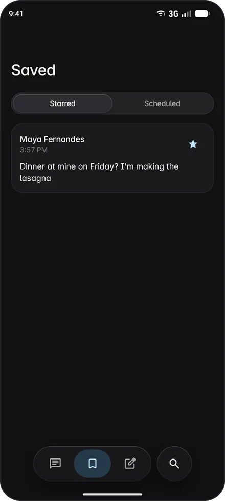

### ⏰ [Alarmzy](https://github.com/Redfox-OSS/Alarmzy-Bedrock)
An alarm clock with **alarm groups**, a feature Google Clock doesn't have and Samsung keeps to its own phones.
- Put alarms into named groups (Work, Gym, Weekend) and switch a whole group on or off with one tap
- Custom repeat days, snooze length, gradual volume and vibration
- Timer and stopwatch that survive reboots, with Android 16 Live Updates
- A full-screen alarm over the lock screen, and a home-screen clock widget with optional weather

  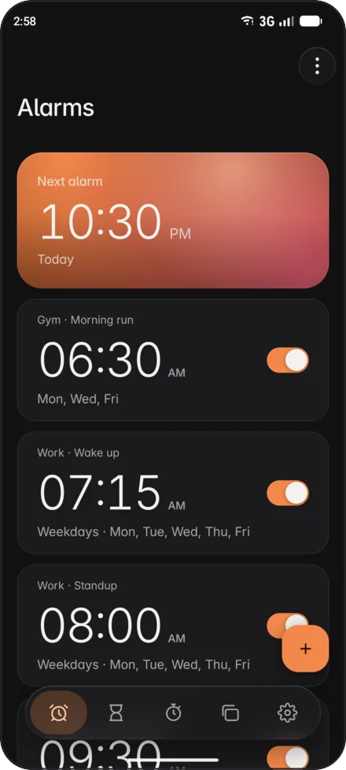
  &nbsp;
  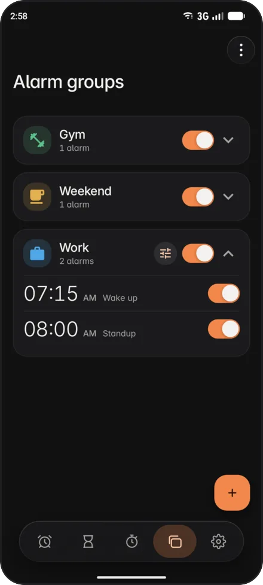
  &nbsp;
  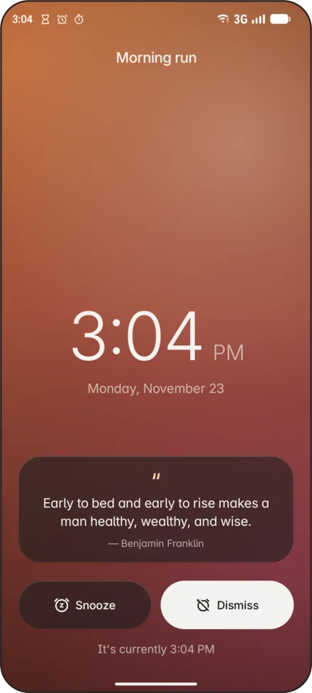

### 🐞 [DebugQS](https://github.com/Redfox-OSS/DebugQS)
Developer options, USB debugging and wireless debugging behind one Quick Settings tile. Banking apps refuse to run with Developer options on, and turning them off in Settings resets everything. DebugQS flips them off and back on without touching the rest.
- One tile opens a panel with all three switches, updated live
- Shows the `adb connect` address while wireless debugging is on, with a copy button
- Guided one-time setup, with Shizuku and Sui support so no computer is needed
- No accounts, no ads, no tracking

  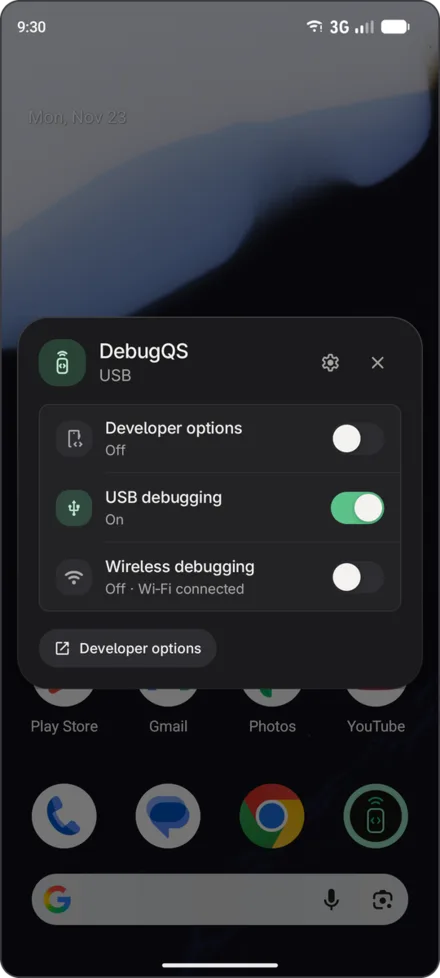
  &nbsp;
  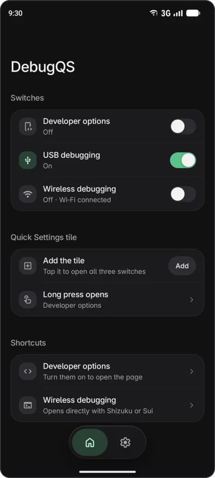
  &nbsp;
  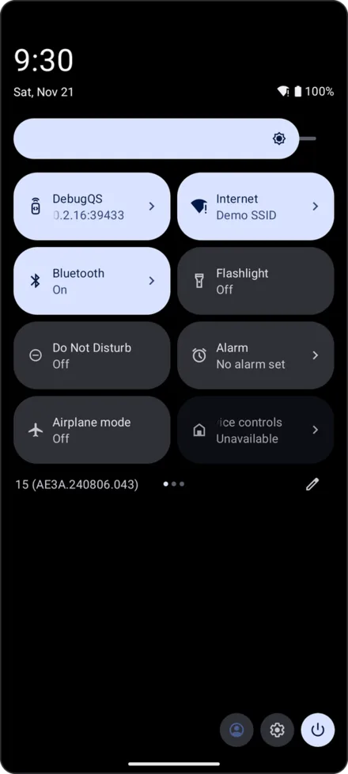

## The design systems

Both are built with Jetpack Compose and free for your own apps too.

### 🪨 [Bedrock](https://github.com/Redfox-OSS/bedrock)
The calm one, and the look of every Redfox app today.
- 6 accent families, 3 neutral ramps, tabular type and concentric radii
- Frosted glass with a lit rim, aura cards, and a nav bar whose pill you can hold and scrub across tabs
- Critically damped motion only: everything arrives and rests
- A catalog app with every token, component and motion spec on a phone · [Guide](https://github.com/Redfox-OSS/bedrock/blob/main/docs/GUIDE.md)

  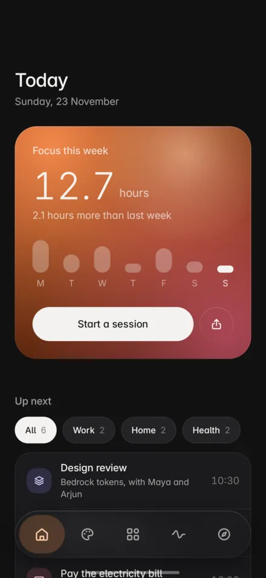
  &nbsp;
  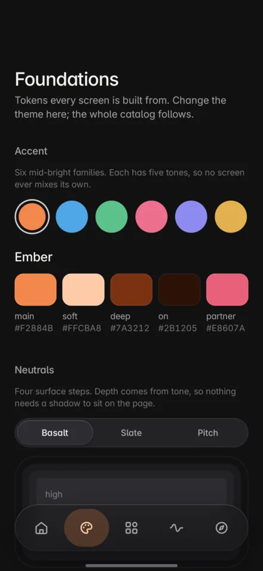
  &nbsp;
  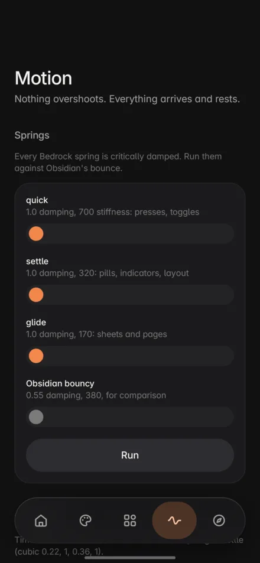

### 🔮 [Obsidian](https://github.com/Redfox-OSS/obsidian)
The original, and Bedrock's louder sibling: always-dark surfaces, a single vivid neon accent, soft coloured glows and springy motion.
- Tokens, glows, frosted glass, motion and dozens of ready-made components
- A catalog app that shows every piece on a real phone
- Published from GitHub Pages: no account or token needed · [Docs](https://redfox-oss.github.io/obsidian/)

## Why Redfox?

| | Stock apps | Redfox OSS |
|---|---|---|
| Source code | Closed | Open, on GitHub |
| Price | Free | Free |
| Design | Fine | Calm, frosted, and it *feels* good |
| Your data | Their cloud, their rules | On your phone |
| Feature missing? | Wait and hope | Open an issue, or send a pull request |

## Get involved

- ⭐ Star the repos you like; it helps others find them.
- 🐛 Found a bug? Open an issue in the app's repository.
- 🛠️ Want to contribute? Read [CONTRIBUTING.md](https://github.com/Redfox-OSS/.github/blob/main/CONTRIBUTING.md) and our [Code of Conduct](https://github.com/Redfox-OSS/.github/blob/main/CODE_OF_CONDUCT.md).
- 🔒 Security problem? Please report it privately; see [SECURITY.md](https://github.com/Redfox-OSS/.github/blob/main/SECURITY.md).

Made with care, and a lot of Ember <code>#F2884B</code>.

